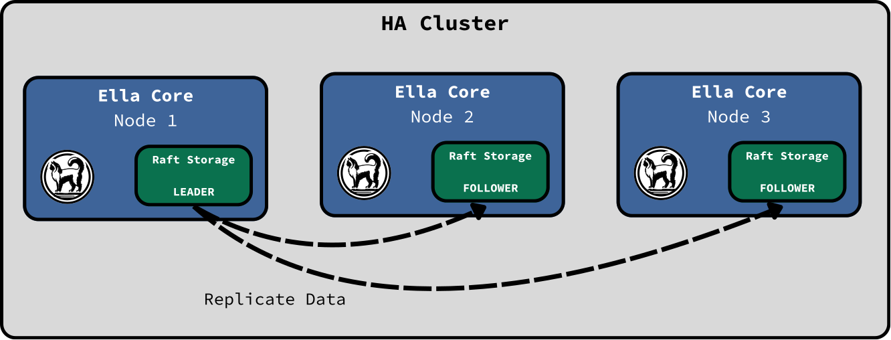
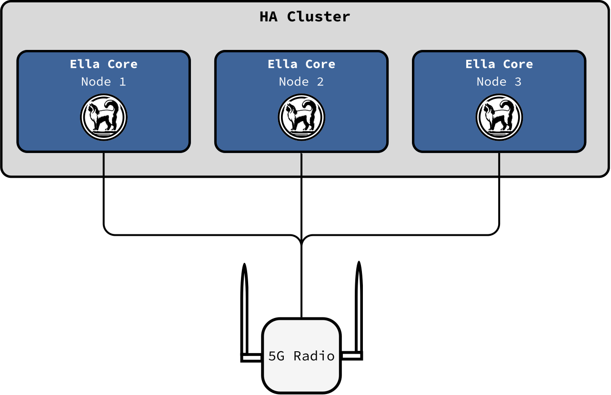
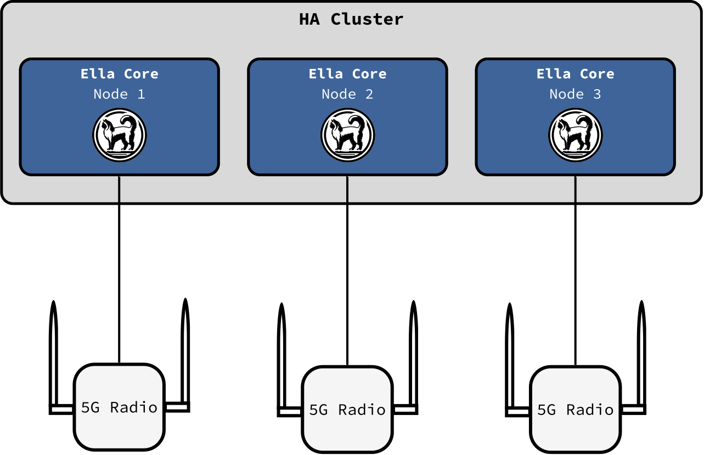

# High Availability

High availability (HA) lets you run an Ella Core cluster so that the network keeps working when nodes fail. Each node is active and can accept radios and subscriber traffic.

HA is designed around the [Raft Consensus Algorithm](https://raft.github.io/): at any time one node is the leader, it is the only node that commits writes, and every write replicates to a majority of voters before it is considered committed. Nodes communicate together via mTLS to share changes.

<figure markdown="span">
  { width="700" }
  <figcaption>High Availability in Ella Core</figcaption>
</figure>

## Failure tolerance

A cluster keeps accepting writes as long as a majority of its *voters* are alive. Deploy an odd number of nodes. We recommend 3 or 5, since an even count adds a node without adding tolerance.

| Voters | Quorum | Failures tolerated |
| ------ | ------ | ------------------ |
| 3      | 2      | 1                  |
| 5      | 3      | 2                  |

Within those bounds, surviving voters keep accepting writes, radio traffic, and operator changes with no manual intervention.

## What replicates, and what does not

Network-wide resources (subscribers, profiles, policies, slices, data networks, network rules, IP leases, users, API tokens, the operator configuration) replicate across the cluster. If a node dies, the survivors hold the same state, automatically elect a new leader, and keep accepting writes.

Per-node configuration (local data-plane and routing settings) does not replicate. Configure those settings on every node.

Runtime state tied to a specific connection or session also does not replicate: SCTP associations with radios, UE contexts, active sessions and their User Plane state, GTP-U tunnels, and active BGP adjacencies.

Observability is per-node: each instance exposes its own Prometheus endpoint, radio events, flow reports, and audit logs, so operators scrape every node for a cluster-wide view.

## Failover

Each Ella Core node presents as a distinct AMF in the same AMF Set (5G) and a distinct MME in a single MME Pool (4G). A UE's GUTI pins it to the node that handled its registration. When a node dies, radios detect the loss and reselect a surviving AMF/MME. UEs that were attached to the dead node then re-register from scratch, including a fresh authentication and a new session.

## User plane and routing

A UE's user-plane traffic flows through the node that handled its registration. In an HA cluster, no two UEs receive the same IP address.

When BGP is enabled, each node advertises a `/32` (IPv4) or `/64` (IPv6) route for every UE session it hosts (see [Advertising routes via BGP](bgp.md)).

## Deployment scenarios

The HA cluster is the same regardless of how radios connect to it. The radio side determines how much HA reaches individual UEs.

### Radios connected to every node (AMF Set / MME Pool)

When a node dies, radios reselect within the AMF Set or MME Pool automatically. Affected UEs re-register on a surviving node without operator action.

<figure markdown="span">
  { width="700" }
  <figcaption>Radios connected to every node (AMF Set / MME Pool)</figcaption>
</figure>

### Radios pinned to specific nodes

Useful for site- or tenant-partitioned deployments. Network-wide state still replicates but if a node dies, its paired radios lose connectivity to the core and must be reconfigured to reach a surviving node.

<figure markdown="span">
  { width="700" }
  <figcaption>Radios pinned to specific nodes</figcaption>
</figure>

## 5G roaming

Every node with `interfaces.n32` in its configuration file is its own SEPP (Security Edge Protection Proxy), the node's endpoint towards the SEPPs of 5G roaming partners. Its SEPP ID is the node's AMF Pointer, and its name is `sepp<SEPP ID>.5gc.mnc<MNC>.mcc<MCC>.3gppnetwork.org`. There is no leader SEPP and no relay between nodes. A node without `interfaces.n32` runs no SEPP and does not serve 5G roamers.

| Replicates | Per node |
| ---------- | -------- |
| Roaming partners, the cluster SEPP CA, each node's SEPP certificate and key | N32 handshakes (contexts), N32 connections, SEPP metrics |

- **Certificates.** A node that has `interfaces.n32` and no certificate gets one signed by the cluster SEPP CA, without operator action, including a node that joins later. Regenerating the CA reissues every generated certificate. A certificate imported for one node replaces that node's certificate only.
- **Handshakes.** Each node handshakes with each partner on its own. A node that fails takes only its own contexts with it, and the partner keeps using the other Ella Core SEPPs. The partner status in the API and the UI shows one entry per SEPP node, and `unknown` for a node that does not answer.
- **Partner SEPPs.** Every node accepts any SEPP of the partner whose certificate chains to the partner's trust anchor and names only the partner's PLMN IDs (TS 33.501 clause 13.1.2), whether it is the SEPP configured for the partner, the SEPP a handshake was redirected to, or another SEPP of the partner that starts its own handshake. Each node sends its own traffic to the configured SEPP, or to the SEPP its handshake was redirected to.
- **Removing a node.** Removing a node deletes its generated certificate: a node that later joins with the same SEPP ID gets a new key under the same name and the same CA, so partners need no change. An imported certificate is kept for the next node with that SEPP ID. Import a new one if the removed host is no longer trusted.
- **Notifications for roamers.** The home network may send its notifications for a roamer (deregistration, subscription data change) to any Ella Core SEPP. A node delivers only the notifications for the UEs it serves. It refuses a notification for a UE of another node with `404`, and the change then applies at the UE's next registration or when its registration expires. Clusters with a single node with `interfaces.n32` are not affected.

## Draining a node

Draining prepares a node for removal without disrupting traffic on its peers. A draining node signals connected radios so new UEs attach elsewhere, and stops advertising user-plane routes so upstream routing shifts to the survivors.

Drain is triggered by an operator via the cluster API or UI.

## Scaling the cluster

To scale up, follow the steps in [Scale Up a High Availability Cluster](../how_to/scale_up_ha_cluster.md).

Shrinking is symmetric. Drain the node, then remove it.

## Inter-node communication using mTLS

Every inter-node connection is mutually authenticated over TLS. Each node owns a long-lived, self-signed cluster certificate. Removing a node immediately revokes its access cluster-wide.

## Disaster recovery

HA clusters recover from total loss through an offline, backup-driven path. An operator stops every node, seeds one node from a backup archive, and starts it. The remaining voters then rejoin with fresh join tokens. The step-by-step procedure lives in [Backup and Restore](../how_to/backup_and_restore.md).

## Rolling upgrades

Upgrades proceed one node at a time: drain the node, refresh its binary, then resume.

Skip-version upgrades (`vN → vN+2`) and downgrades are not supported.

## Further reading

- [Deploy a High Availability Cluster](../how_to/deploy_ha_cluster.md) — step-by-step guide to bring up a cluster.
- [Scale Up a High Availability Cluster](../how_to/scale_up_ha_cluster.md) — add nodes to an existing cluster.
- [Perform a Rolling Upgrade](../how_to/rolling_upgrade.md) — upgrade every node without taking the cluster offline.
- [Cluster API reference](../reference/api/cluster.md) — cluster management endpoints.
