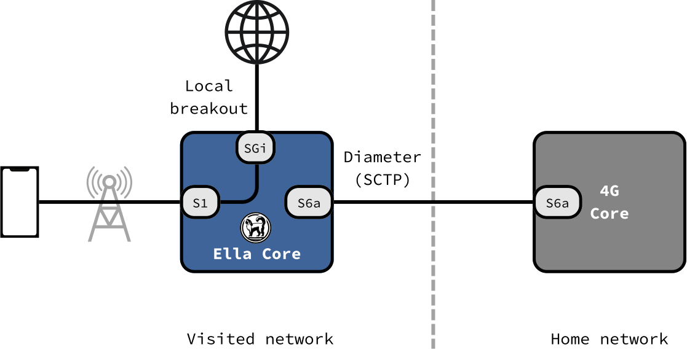

# Roaming

Ella Core lets subscribers of partner networks attach over 4G and 5G, with Ella Core as the visited network. Their home network authenticates them and holds their subscription. Ella Core carries their traffic to its local data networks (local breakout).

## Local breakout

Ella Core supports local breakout for roaming subscribers, their traffic is routed to the local data networks instead of back to their home network.

### 5G

In 5G, Ella Core reaches the partner's 5G core through its SEPP, over N32. Each side trusts the other's certificate authority.

<figure markdown="span">
  { width="700" }
  <figcaption>5G roaming</figcaption>
</figure>

### 4G

In 4G, Ella Core reaches the partner's HSS over S6a, directly or through a Diameter Edge Agent.

<figure markdown="span">
  { width="700" }
  <figcaption>4G roaming</figcaption>
</figure>

## Roaming partners

A roaming partner is an agreement with another operator. It has:

- **PLMN IDs**: the partner's MCC and MNC. Ella Core recognizes the partner's subscribers by their IMSI.
- **A profile**: the policy applied to the partner's subscribers, like any [profile](../reference/api/profiles.md).
- **A 5G agreement, a 4G agreement, or both**: how Ella Core reaches the partner's network.

## Roamers

A roamer is a subscriber from a partner network who is currently roaming in Ella Core's network.

- Roamers are listed on the **Roamers** tab of the **Roaming** page.
- It appears when it registers and disappears when it leaves.
- Roamers count toward the maximum number of subscribers.
- Roamers get data only: no SMS and no voice.
- Deleting a partner deregisters its roamers.

## In an HA cluster

Each node of a [High Availability](high_availability.md) cluster connects to the partner on its own, so the partner must accept every node. See [Roaming in an HA cluster](high_availability.md#roaming).

## Further reading

- [Configure Roaming](../how_to/configure_roaming.md) — step-by-step guide to add a roaming partner.
- [Roaming API reference](../reference/api/roaming.md) — partners, Diameter peers, SEPP, roamers, and usage.
- [3GPP Compliance](../reference/3gpp_compliance.md) — supported roaming procedures.
