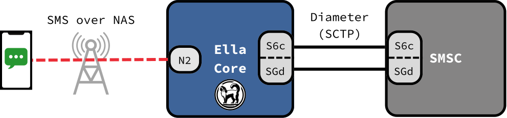
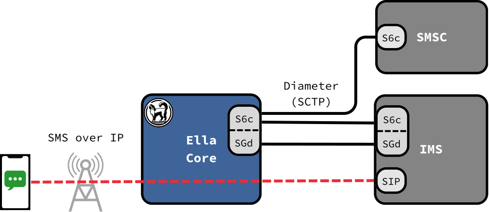

# SMS Integration

Ella Core lets subscribers send and receive SMS over 4G and 5G. Messages are stored and forwarded by an external Short Message Service Center (SMSC), such as [Ella SMSC](https://docs.ellanetworks.com/smsc/). Ella Core works with any 3GPP-compliant SMSC.

A phone exchanges SMS in one of two ways: over NAS, through Ella Core, or over IP, through an IMS.

## SMS over NAS

<figure markdown="span">
  { width="700" }
  <figcaption>SMS over NAS</figcaption>
</figure>

The message travels inside the signalling between the phone and Ella Core. Ella Core carries it to and from the SMSC, as the MME on 4G or the SMSF on 5G.

As the HSS, Ella Core tells the SMSC where each recipient is served. When a phone that missed messages is reachable again, Ella Core alerts the SMSC.

## SMS over IP

<figure markdown="span">
  { width="700" }
  <figcaption>SMS over IP</figcaption>
</figure>

The message travels as SIP through the IMS, whose IP-SM-GW carries it to and from the SMSC. Ella Core carries the SIP in the user plane, like any other IMS traffic.

As the HSS, Ella Core sends the SMSC's routing requests to the IP-SM-GW while the phone is registered for SMS over IP. If the IMS cannot deliver a message, the IP-SM-GW sends it through Ella Core over NAS.

## Who can use SMS

Ella Core allows SMS when:

- At least one SMSC is configured.
- Ella Core's SMS number is set. This is the number Ella Core gives the SMSC for itself, as the node serving the phone.
- The subscriber has an MSISDN.

On 5G, the phone asks for SMS when it registers. On 4G, the phone asks with a combined attach, and Ella Core accepts it for SMS only.

## SMSCs with several nodes

An SMSC can have several Diameter nodes, ex. the members of an Ella SMSC cluster. Ella Core sends each message and alert to one open node, and to the next one if that node fails.

## In an HA cluster

Each node of a [High Availability](high_availability.md) cluster connects to every SMSC node.

- **Receiving**: Ella Core answers routing requests with the node that serves the recipient, so the SMSC delivers each message to the right node.
- **Undelivered messages**: The record of waiting messages replicates across the cluster, so the node serving the phone when it becomes reachable can alert the SMSC.

## Further reading

- [Enable SMS](../how_to/enable_sms.md) — step-by-step guide to enable SMS.
- [Operator API reference](../reference/api/operator.md) — SMS number and SMSCs.
- [3GPP Compliance](../reference/3gpp_compliance.md) — supported SGd and S6c procedures.
- [Enable SMS over IP](https://docs.ellanetworks.com/ims/how_to/enable_sms_over_ip/) — SMS over IP with Ella IMS.
