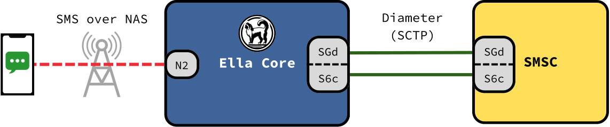

# SMS Integration

Ella Core lets subscribers send and receive SMS over 4G and 5G. Messages are stored and forwarded by an external Short Message Service Center (SMSC), and Ella Core carries them between the phones and the SMSC.

Ella Core works with any 3GPP-compliant SMSC, for example [Ella SMSC](https://github.com/ellanetworks/smsc).

<figure markdown="span">
  { width="700" }
  <figcaption>Ella Core and the SMSC</figcaption>
</figure>

## The role of Ella Core

Ella Core connects to each SMSC over Diameter (SCTP), and plays two roles:

| Role | Interface | Used for |
| ---- | --------- | -------- |
| MME (4G) / SMSF (5G) | SGd | Carrying messages between the phones and the SMSC. |
| HSS | S6c | Telling the SMSC where to deliver messages, and when a phone can receive them again. |

Messages travel between the phone and Ella Core inside NAS signalling (SMS over NAS).

## Who can use SMS

Ella Core allows SMS when all of the following hold:

- At least one SMSC is configured.
- Ella Core's SMS number is set on the Operator page.
- The subscriber has an MSISDN.

On 5G, the phone asks for SMS when it registers. On 4G, the phone asks with a combined attach, and Ella Core accepts it for SMS only.

## Delivery

- **Sending**: Ella Core forwards the phone's message over SGd to the SMSC that serves the SMSC number stored on the phone's SIM.
- **Receiving**: The SMSC asks Ella Core over S6c where the recipient is served, then sends the message over SGd. Ella Core pages the phone if it is idle and delivers the message.
- **Undelivered messages**: When the phone is unreachable or its memory is full, Ella Core records that a message is waiting, and alerts the SMSC over S6c once the phone can receive it.

## In an HA cluster

Each node of a [High Availability](high_availability.md) cluster connects to every SMSC.

- **Receiving**: Ella Core answers routing requests with the node that serves the recipient, so the SMSC delivers each message to the right node.
- **Undelivered messages**: The record of waiting messages replicates across the cluster, so the node serving the phone when it becomes reachable can alert the SMSC.

## Further reading

- [Enable SMS](../how_to/enable_sms.md) — step-by-step guide to enable SMS.
- [Operator API reference](../reference/api/operator.md) — SMS number and SMSC peers.
- [3GPP Compliance](../reference/3gpp_compliance.md) — supported SGd and S6c procedures.
