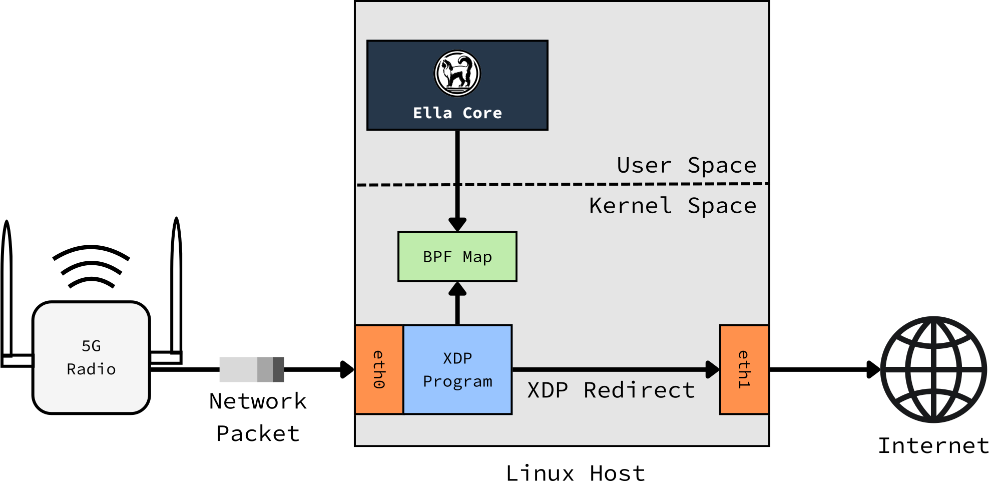

# Data Plane Packet processing with eBPF

This document explains the key concepts behind Ella Core's subscriber data packet processing.

Ella Core processes subscriber packets between the **N3 / S1-U** and **N6 / SGi** interfaces.

## eBPF, XDP, and TCX

[eBPF](https://ebpf.io/) lets custom programs run in the Linux kernel, and is widely used in networking, security, and performance monitoring.

Ella Core's data plane is an eBPF program, attached at one of two kernel hooks:

- [XDP](https://www.iovisor.org/technology/xdp) runs in the network driver, before the kernel builds a socket buffer, and requires driver support.
- TCX runs later on the socket buffer and is available on every interface.

[Attach modes](#attach-modes) covers the trade-off.

## Data Plane Packet processing in Ella Core

Ella Core's data plane uses eBPF to achieve high throughput and low latency. Key features include:

- **Policy rules enforcement**: Evaluating ordered per-policy uplink and downlink rules to allow or deny traffic based on remote prefix, protocol, and port range.
- **Encapsulation and decapsulation**: Managing GTP-U (GPRS Tunneling Protocol-User Plane) headers for data transmission.
- **Rate limiting**: Enforcing Quality of Service (QoS) with QER (QoS Enforcement Rules).
- **Flow reporting**: Recording per-flow traffic details including source, destination, protocol, port, and whether the flow was allowed or dropped.
- **Usage reporting**: Aggregating per-subscriber byte counts for data usage tracking.
- **Statistics collection**: Monitoring metrics such as packet counts, drops, and processing times.

<figure markdown="span">
  { width="800" }
  <figcaption>Packet processing in Ella Core with eBPF and XDP (Simplified to only show N3->N6).</figcaption>
</figure>

### Routing

Ella Core relies on the kernel to make routing decisions for incoming network packets. Kernel routes can be configured using the [Networking API](../reference/api/networking.md) or the user interface.

### Performance

Detailed performance results are available [here](../reference/performance.md).

### Attach modes

The data plane can attach at either of two kernel hooks:

- **xdp-native** runs in the network driver, before the kernel builds a socket buffer. It is the fastest option, but it needs a driver that supports the hook.

- **tcx** runs on the socket buffer, after the kernel's receive path. It is available on every interface, including the veth pairs used in containers and [co-hosted deployments](../how_to/co_host_with_ocudu.md). It is the option that always works.

### Why merged packets must be disabled

`tcx` runs on the socket buffer, which can hold several packets merged together by the kernel's receive path (GRO, hardware GRO or LRO). Ella Core can't produce valid GTP-U from a merged buffer. On encapsulation, the kernel later splits the buffer back into wire-sized packets and copies the GTP-U header unchanged into each one, so every packet would claim the whole buffer's payload length. On decapsulation, removing the outer headers would remove only the first packet's, and leave the others' GTP-U headers inside the payload. Ella Core drops merged buffers instead, and counts them in `app_upf_datapath_drop_total` under `encap_gso` and `decap_gso`.

To keep those drops from happening, Ella Core turns off packet merging on N3 and N6 before it attaches in `tcx` mode, so the datapath never sees merged traffic. A feature that the driver or hypervisor fixes on can't be turned off, and Ella Core logs a warning for it.

`xdp-native` sees each frame before the kernel merges anything. In `xdp-generic` mode, the kernel itself skips GRO and turns off hardware GRO and LRO on an interface with a generic XDP program, so Ella Core leaves the interface alone.

Two cases remain outside Ella Core's reach:

- **veth**: a veth also receives packets merged by its peer when the peer offloads segmentation. That merge happens on the other side of the pair, so it must be turned off on the peer.
- **macvlan and ipvlan**: these interfaces receive packets from their lower device, and GRO runs on the lower device before the packets reach them. Changing the macvlan or ipvlan interface has no effect, and the lower device is often in another network namespace or shared with other workloads, so Ella Core logs a warning and leaves it to the operator.

### XDP redirect on veth pairs

When Ella Core's N3 or N6 interface is a veth pair, the data plane redirects packets out of it. In `xdp-native` mode the veth driver delivers redirected frames only when the receiving peer has an XDP program attached or GRO enabled; otherwise they are dropped. Attaching a minimal `XDP_PASS` program to the peer is the usual fix. See [Use native XDP with veth interfaces](../how_to/native_xdp_veth.md) for the steps.

### IPv6 GTP-U transport

GTP-U tunnels on N3 / S1-U run over either IPv4 or IPv6. The inner UE payload family is independent of the outer header family.

Which family is used depends on the interface configuration and on the radio. When N3 is set by `name`, Ella Core advertises both of the interface's addresses and the radio picks one. When both sides support both families, IPv6 is used. To pin a family, configure N3 with an `address` of that family.
