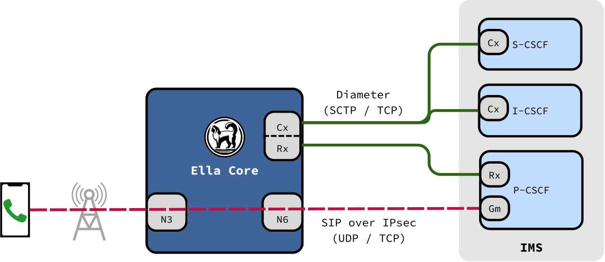

# Voice Integration

Ella Core lets subscribers make voice and video calls over 4G (VoLTE) and 5G (VoNR). Calls are handled by an external IP Multimedia Subsystem (IMS), and Ella Core provides the subscriber data and the Quality of Service (QoS) the IMS needs. The same integration serves other IMS services, such as Mission Critical Push To Talk (MCPTT).

## What is an IMS?

An IMS is the system that sets up and routes calls in a mobile network. Phones talk to it using SIP, over a regular data session. Its main components are Call Session Control Functions (CSCFs):

- **P-CSCF (Proxy)**: The phone's first point of contact with the IMS.
- **I-CSCF (Interrogating)**: Finds the S-CSCF serving a subscriber.
- **S-CSCF (Serving)**: Registers subscribers and routes their calls.

Ella Core works with any 3GPP-compliant IMS. It has been validated against:

- [Ella IMS](https://github.com/ellanetworks/ims)
- [Kamailio](https://github.com/kamailio/kamailio), which has [known deviations from 3GPP and IETF specifications](https://github.com/kamailio/kamailio/issues/5027)
- [OpenSIPS](https://github.com/OpenSIPS/opensips), which has [known deviations from 3GPP and IETF specifications](https://github.com/OpenSIPS/opensips/issues/4386)

<figure markdown="span">
  { width="700" }
  <figcaption>Ella Core and the IMS</figcaption>
</figure>

## The role of Ella Core

Ella Core plays two roles for the IMS, both over Diameter:

| Role | Interface | Used for |
| ---- | --------- | -------- |
| HSS | Cx | Subscriber identities, authentication, the S-CSCF assigned to each subscriber, and the application servers that serve them. |
| PCRF / PCF | Rx | QoS for the media of each call. |

Both interfaces are used for 4G and 5G subscribers. The IMS connects to Ella Core's Diameter interface, over SCTP or TCP.

Ella Core also carries the phone's traffic to and from the IMS, on an IMS data network, usually named `ims`.

## IMS data networks

An IMS data network carries the phones' SIP signalling and call media. Any data network can be marked as IMS; there can be several, for example `ims` for phones and a separate one for mission critical devices.

- **P-CSCF discovery**: When a phone opens a session on an IMS data network, Ella Core gives it the P-CSCF addresses configured in the Operator settings, of the IP version the phone requested.
- **Signalling QoS**: The session's default QoS uses 5QI / QCI 5, the standard class for IMS signalling, or 69 for mission critical signalling.
- **No NAT**: Traffic on an IMS data network is never translated, so the IMS can reach phones at their own IP address.
- **UE-to-UE**: Traffic between two phones on an IMS data network is always switched locally, so calls between them work even when local switching is disabled.

## IMS identities

Ella Core derives each subscriber's IMS identities from its existing data. No IMS-specific provisioning is needed.

| Identity | Format | Example |
| -------- | ------ | ------- |
| Private identity (IMPI) | `<imsi>@<IMS home domain>` | `001010100007487@ims.mnc001.mcc001.3gppnetwork.org` |
| Public identity (IMPU) | `tel:+<msisdn>` | `tel:+15551230001` |
| Public identity (IMPU), barred | `sip:<private identity>` | `sip:001010100007487@ims.mnc001.mcc001.3gppnetwork.org` |

The IMS home domain is `ims.mnc<MNC>.mcc<MCC>.3gppnetwork.org`, built from the operator's PLMN ID.

The `sip:` identity is barred, so it cannot be used for calls. A subscriber without an MSISDN has no usable public identity, and cannot make or receive calls.

## Voice support indication

During registration (5G) or attach and tracking area update (4G), Ella Core tells each phone whether IMS voice is supported. Phones rely on it to decide whether to use VoLTE or VoNR.

Ella Core indicates IMS voice support when all of the following hold:

- At least one P-CSCF address is configured.
- The data network named `ims`, the IMS well-known APN that phones use for voice (GSMA IR.92), exists and is marked as IMS, with an IP pool of the same version as one of the P-CSCF addresses.
- The subscriber's profile has a policy on the `ims` data network.
- The subscriber has an MSISDN.

A policy on another IMS data network, such as one for mission critical services, lets the subscriber register with the IMS but does not offer voice over PS.

On the Subscriber page, **Voice** shows the subscriber's voice state and, when voice is off, which condition is missing.

## Application servers and filter criteria

Services such as MCPTT run on application servers: SIP servers that the S-CSCF sends some of a subscriber's requests to. Application servers are configured in the Operator settings, and each has:

- A **server name**: the SIP URI the S-CSCF sends requests to.
- **Public Service Identities (PSIs)**: the SIP or tel URIs the server hosts, distinct or wildcarded with an extended regular expression between `!` delimiters, for example `sip:!.*!@mcptt.ims.mnc001.mcc001.3gppnetwork.org` (TS 23.003 §13.5). When the IMS asks Ella Core where to send a request addressed to a PSI, Ella Core answers with the application server, and the I-CSCF sends the request straight to it.

Each profile has an ordered list of **IMS initial filter criteria** (TS 29.228). A filter criterion sends the requests of the profile's subscribers that match its trigger, such as a SIP method or header, to an application server. It can also ask the S-CSCF to include the subscriber's REGISTER request and its response in the third-party REGISTER it sends to the application server. Ella Core gives the profile's filter criteria to the S-CSCF in each subscriber's user profile, in the profile's order.

When a profile's filter criteria, an application server's server name, or a subscriber's profile or MSISDN changes, Ella Core sends the new user profile to the S-CSCF serving each affected subscriber, with a Cx Push Profile request. An S-CSCF that does not support it gets the new user profile at the subscriber's next registration. When a registered subscriber's MSISDN changes or is removed, Ella Core de-registers the subscriber instead, since its default public identity changes.

The UI has a preset with the filter criteria for MCPTT. See [Enable MCPTT](../how_to/enable_mcptt.md).

## Call setup and QoS

1. During call setup, the P-CSCF describes the call's media to Ella Core over Rx: its type, IP addresses, ports, and bandwidth.
2. Ella Core creates a guaranteed bitrate (GBR) QoS flow (5G) or dedicated bearer (4G) for the media, on the phone's IMS session.
3. When the call ends, the P-CSCF closes the Rx session and Ella Core releases the QoS flow or bearer.

| Media | 5QI / QCI | ARP priority |
| ----- | --------- | ------------ |
| Voice | 1 | 2 |
| Video | 2 | 4 |
| MCPTT voice and floor control | 65 | 1 to 8, from the call's Resource-Priority |

A call is MCPTT when the P-CSCF identifies it with the MCPTT ICSI. Its voice and floor control share one GBR QoS flow or bearer, and a change of the call's priority modifies that QoS flow or bearer in place. See [Enable MCPTT](../how_to/enable_mcptt.md#7-check-the-call-qos) for the ARP of each priority.

## EPS fallback

Some 5G radios are configured not to carry voice calls. When a voice call starts, such a radio refuses the voice QoS flow and moves the phone to 4G, where Ella Core sets up the call's QoS as a dedicated bearer.

## In an HA cluster

Each node of a [High Availability](high_availability.md) cluster is a separate Diameter peer of the IMS.

- **Cx**: Any node can answer. IMS registrations replicate across the cluster.
- **Rx**: The QoS for a call must be set up by the node that holds the phone's session. When the IMS reaches another node, that node redirects it to the right one.

## Further reading

- [Enable Voice](../how_to/enable_voice.md) — step-by-step guide to enable voice and video calls.
- [Enable MCPTT](../how_to/enable_mcptt.md) — step-by-step guide to serve MCPTT.
- [Operator API reference](../reference/api/operator.md) — P-CSCF addresses, voice status, and IMS application servers.
- [Profiles API reference](../reference/api/profiles.md) — IMS initial filter criteria.
- [Subscribers API reference](../reference/api/subscribers.md) — IMS identities and registration state.
- [3GPP Compliance](../reference/3gpp_compliance.md) — supported Cx and Rx procedures.
