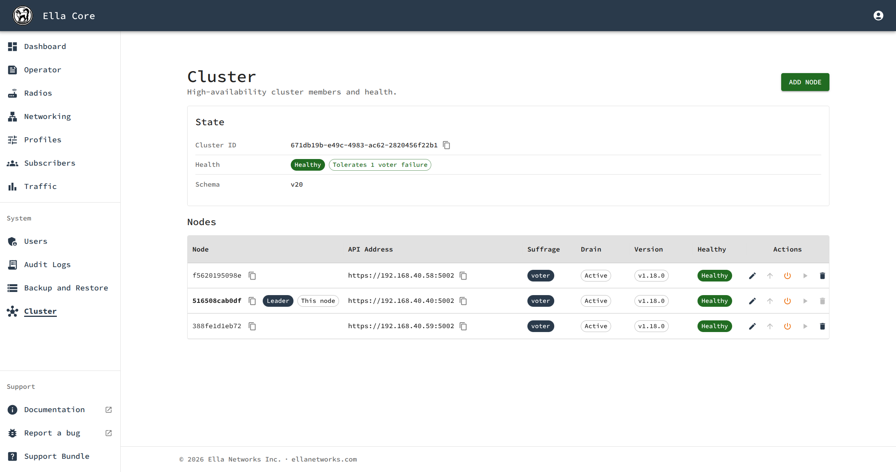

# Deploy a High Availability Cluster

Ella Core can be deployed as a high-availability cluster to provide redundancy and failover capabilities. See [High Availability](../explanation/high_availability.md) for more information.

## Prerequisites

=== "Hosts"

    - Three hosts meeting the standard [system requirements](../reference/system_reqs.md).
    - Ella Core installed on each host via the [Install](install.md) guide with `cluster.bind-address` set in the configuration file.

=== "Kubernetes"

    - A Kubernetes cluster meeting the [Kubernetes requirements](../reference/system_reqs.md#kubernetes).

## 1. Deploy the nodes

=== "Hosts"

    Start Ella Core on each host.

=== "Kubernetes"

    Create the namespace:

    ```bash
    kubectl create namespace ella
    kubectl label namespace ella pod-security.kubernetes.io/enforce=privileged pod-security.kubernetes.io/warn=privileged
    ```

    Create `values.yaml`. Set `master` to the host interface that connects to your radios, and each node's `ranAddress` to its N2/N3 address:

    ```yaml
    nodes:
      - ranAddress: 192.168.252.3/24
      - ranAddress: 192.168.252.4/24
      - ranAddress: 192.168.252.5/24
    ran:
      networkAttachment:
        master: eth1
    ```

    Deploy Ella Core:

    ```bash
    helm install ella-core oci://ghcr.io/ellanetworks/charts/ella-core --version v1.22.0 --namespace ella -f values.yaml
    ```

    Open each node's API in a separate terminal:

    ```bash
    kubectl -n ella port-forward pod/ella-core-1-0 5002:5002
    kubectl -n ella port-forward pod/ella-core-2-0 5003:5002
    kubectl -n ella port-forward pod/ella-core-3-0 5004:5002
    ```

    The API addresses of nodes 1, 2 and 3 are `http://localhost:5002`, `http://localhost:5003` and `http://localhost:5004`.

## 2. Initialize node 1

Open a browser at node 1's API address and initialize it normally.

## 3. Create a join token for node 2

Still in node 1, open the **Cluster** page and click **Add Node**, click **Mint Token**, then copy the token.

## 4. Join node 2

Open a browser at node 2's API address and click **Join an existing cluster instead**. Paste the token, enter node 1's cluster address, and click **Join**.

=== "Hosts"

    Node 1's cluster address is its `cluster.bind-address`.

=== "Kubernetes"

    Node 1's cluster address is `ella-core-1-0.ella-core-headless.ella.svc.cluster.local:7000`.

## 5. Add node 3

Repeat steps 3 and 4 for node 3.

## 6. Verify

On the **Cluster** page, all three nodes appear as **Healthy**.

<figure markdown="span">
  { width="800" }
</figure>
