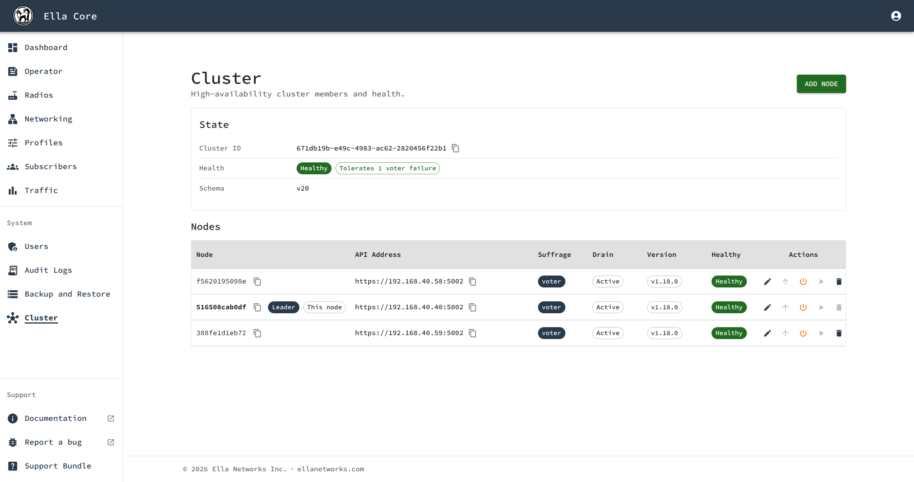

# Deploy a High Availability Cluster

Ella Core can be deployed as a high-availability cluster to provide redundancy and failover capabilities. See [High Availability](../explanation/high_availability.md) for more information.

## Prerequisites

- Three hosts meeting the standard [system requirements](../reference/system_reqs.md).
- Ella Core installed on each host via the [Install](install.md) guide with `cluster.bind-address` set in the configuration file.

## 1. Start node 1

Start node 1, open a browser at the API address and initialize it normally.

## 2. Create a join token for node 2

Still in node 1, open the **Cluster** page and click **Add Node**, click **Mint Token**, then copy the token.

## 3. Start node 2

Start node 2, open a browser at the API address and click **Join an existing cluster instead**. Paste the token, enter node 1's cluster address, and click **Join**.

## 4. Add node 3

Repeat steps 2 and 3 for node 3.

## 5. Verify

On the **Cluster** page, all three nodes appear as **Healthy**.

<figure markdown="span">
  { width="800" }
</figure>

## 6. (Optional) Enable 5G roaming

Each node that serves 5G roamers is its own SEPP. See [5G roaming](../explanation/high_availability.md#5g-roaming).

On each node that should serve 5G roamers, set `interfaces.n32` in the [configuration file](../reference/config_file.md) and restart Ella Core. The node creates its SEPP certificate with the cluster SEPP CA.

On the **Roaming** page, open the **SEPP** tab. Every node with `interfaces.n32` appears with its SEPP ID, FQDN and certificate.

Give each roaming partner:

- **Every SEPP of the cluster**: the FQDN of each node with `interfaces.n32` and the address and port it listens on, e.g. `sepp1.5gc.mnc001.mcc001.3gppnetwork.org` at `10.0.0.11:443`. Publish each FQDN in DNS, and the SRV records `_n32._tcp.sepp.5gc.mnc<MNC>.mcc<MCC>.3gppnetwork.org` naming each of them for partners that discover SEPPs. A partner SEPP that keeps a list of peer SEPPs needs every node in that list.
- **The trust anchors** listed on the **SEPP** tab: the cluster SEPP CA covers every node with a generated certificate, and each imported certificate adds the CA that issued it.
- **The source addresses**: each node connects to the partner from its `interfaces.n32` address, so the partner's firewall must allow every node.

Each node then handshakes with each partner on its own. On the **Partners** tab, the partner shows one N32 status per SEPP node.
