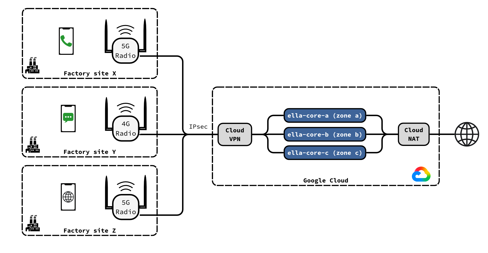

# Deploy on Google Cloud

Deploy a three-node Ella Core cluster across three zones and connect a radio to it over IPsec.

<figure markdown="span">
  { width="800" }
  <figcaption>Ella Core running in Google Cloud</figcaption>
</figure>

## Prerequisites

- A Google Cloud project and the `gcloud` CLI.
- A radio that supports IPsec and several MME or AMF addresses. Without IPsec on the radio, use an IPsec router at the site.

The examples use `203.0.113.10` for the site's public address, `192.168.1.50` for the radio, and `10.128.0.0/20` for the `default` subnet in `us-central1`.

## 1. Prepare the project

Set the project and region:

```shell
gcloud config set project <project>
R="--region us-central1"
```

Allow the radio to reach Ella Core:

```shell
gcloud compute firewall-rules create ella-core-allow-radio --network default \
  --allow sctp:36412,sctp:38412,udp:2152,icmp \
  --source-ranges 192.168.1.50/32 --target-tags ella-core
```

Allow Identity-Aware Proxy (IAP) to reach the UI:

```shell
gcloud compute firewall-rules create ella-core-allow-iap-ui --network default \
  --allow tcp:5002 --source-ranges 35.235.240.0/20 --target-tags ella-core
```

Give the VMs internet access:

```shell
gcloud compute routers create ella-nat-router --network default $R
gcloud compute routers nats create ella-nat --router ella-nat-router $R \
  --auto-allocate-nat-external-ips --nat-all-subnet-ip-ranges
```

## 2. Create the VPN gateway

Create a Classic VPN gateway:

```shell
gcloud compute addresses create radio-vpn-ip $R
GW=$(gcloud compute addresses describe radio-vpn-ip $R --format='value(address)')
echo $GW
gcloud compute target-vpn-gateways create radio-vpn --network default $R
gcloud compute forwarding-rules create radio-vpn-esp $R --address $GW --target-vpn-gateway radio-vpn --ip-protocol ESP
gcloud compute forwarding-rules create radio-vpn-udp500 $R --address $GW --target-vpn-gateway radio-vpn --ip-protocol UDP --ports 500
gcloud compute forwarding-rules create radio-vpn-udp4500 $R --address $GW --target-vpn-gateway radio-vpn --ip-protocol UDP --ports 4500
```

Create a pre-shared key, the tunnel, and a route to the radio:

```shell
head -c 32 /dev/urandom | base64 | tr -d '/+=' | head -c 32 > radio-vpn.psk
gcloud compute vpn-tunnels create radio-tunnel $R --target-vpn-gateway radio-vpn \
  --peer-address 203.0.113.10 --ike-version 2 --shared-secret "$(cat radio-vpn.psk)" \
  --local-traffic-selector 10.128.0.0/20 --remote-traffic-selector 192.168.1.50/32
gcloud compute routes create radio-route --network default --destination-range 192.168.1.50/32 \
  --next-hop-vpn-tunnel radio-tunnel --next-hop-vpn-tunnel-region us-central1
```

## 3. Create the VMs

Create one VM per zone, at `10.128.0.10`, `10.128.0.11` and `10.128.0.12`:

```shell
i=10
for z in a b c; do
  gcloud compute instances create ella-core-$z --zone us-central1-$z \
    --machine-type e2-standard-2 --subnet default --private-network-ip 10.128.0.$i \
    --no-address --tags ella-core \
    --image-family ubuntu-2404-lts-amd64 --image-project ubuntu-os-cloud \
    --boot-disk-size 20GB
  i=$((i+1))
done
```

## 4. Install Ella Core

On each VM:

```shell
gcloud compute ssh ella-core-<z> --zone us-central1-<z> --tunnel-through-iap
```

Disable merged packets on `ens4`, now and at every boot:

```shell
sudo tee /etc/systemd/system/ens4-no-gro.service <<'EOF'
[Unit]
After=network-online.target
Before=snap.ella-core.cored.service
[Service]
Type=oneshot
ExecStart=/usr/sbin/ethtool -K ens4 gro off rx-gro-hw off
[Install]
WantedBy=multi-user.target
EOF
sudo systemctl enable --now ens4-no-gro
```

Install Ella Core:

```shell
sudo snap install ella-core
```

Replace `/var/snap/ella-core/common/core.yaml` with the following, setting `bind-address` to the VM's address:

```yaml
logging:
  system:
    level: "info"
    output: "stdout"
  audit:
    output: "stdout"
db:
  path: "/var/snap/ella-core/common/data/ella.db"
interfaces:
  n2:
    name: "ens4"
  n3:
    name: "ens4"
  n6:
    name: "ens4"
  api:
    address: "0.0.0.0"
    port: 5002
    tls:
      cert: "/var/snap/ella-core/common/cert.pem"
      key: "/var/snap/ella-core/common/key.pem"
datapath:
  attach-mode: "tcx"
cluster:
  bind-address: "10.128.0.10:7000"
```

Start Ella Core:

```shell
sudo snap start --enable ella-core.cored
```

## 5. Form the cluster

Open each node's UI through IAP, each in its own terminal:

```shell
gcloud compute start-iap-tunnel ella-core-a 5002 --local-host-port=localhost:5002 --zone us-central1-a
gcloud compute start-iap-tunnel ella-core-b 5002 --local-host-port=localhost:5003 --zone us-central1-b
gcloud compute start-iap-tunnel ella-core-c 5002 --local-host-port=localhost:5004 --zone us-central1-c
```

1. Open `https://localhost:5002` and initialize node a.
2. Open **Cluster**, click **Add Node**, click **Mint Token**, and copy the token.
3. Open `https://localhost:5003`, click **Join an existing cluster instead**, paste the token, enter `10.128.0.10:7000`, and click **Join**.
4. Repeat steps 2 and 3 for node c, at `https://localhost:5004`.

On the **Cluster** page, the three nodes appear as **Healthy**.

## 6. Configure the network

In the UI:

1. In **Operator**, set the MCC, MNC and TAC to match the radio and SIM cards.
2. In **Data Networks**, open `internet` and set its MTU to `1300`.
3. In **Subscribers**, add each SIM card.

## 7. Connect the radio

Give the radio a static address on the site network, e.g. `192.168.1.50/24` with gateway `192.168.1.1`.

Configure an IPsec tunnel on the radio:

| Setting | Value |
|---|---|
| Peer | The VPN gateway address (`$GW`) |
| IKE version | IKEv2 |
| Authentication | The pre-shared key in `radio-vpn.psk` |
| Local ID | The site's public address, e.g. `203.0.113.10` |
| Remote ID | The VPN gateway address |
| Local subnet | `192.168.1.50/32` |
| Remote subnet | `10.128.0.0/20` |
| IKE and ESP | AES-256, SHA-256, DH group 14 (MODP 2048) |
| IKE lifetime | 10 h or less |
| IPsec SA lifetime | 3 h or less |

Set the radio's MME (4G) or AMF (5G) addresses to `10.128.0.10`, `10.128.0.11` and `10.128.0.12`, then restart the radio.

## 8. Verify

Check that the tunnel is up:

```shell
gcloud compute vpn-tunnels describe radio-tunnel $R --format='value(status)'
```

The output is `ESTABLISHED`. The radio appears on the **Radios** page, and attached phones appear as **Registered** on the **Subscribers** page.
