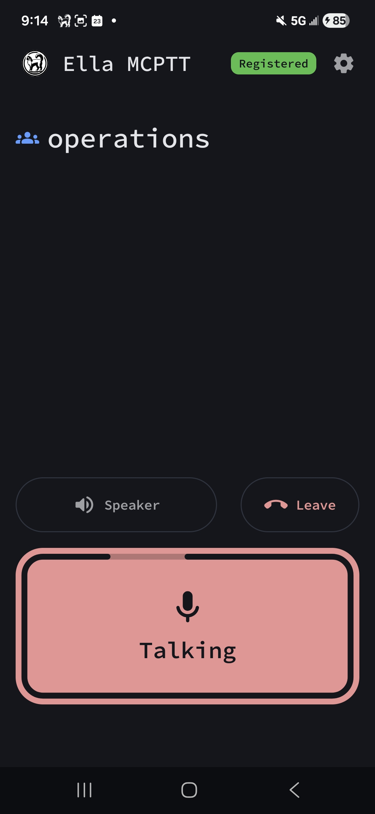

# Enable MCPTT

This guide shows how to serve Mission Critical Push To Talk (MCPTT) to subscribers over 4G and 5G, with an external IMS and an MCPTT server. To learn how Ella Core works with the IMS, see [IMS Integration](../explanation/ims_integration.md).

## Prerequisites

- **IMS**: an IMS integrated with Ella Core, as in [Integrate with an IMS](integrate_with_ims.md). Its P-CSCF must send the MCPTT ICSI, `urn:urn-7:3gpp-service.ims.icsi.mcptt`, in the AF-Application-Identifier of MCPTT calls.
- **MCPTT server**: [Ella IMS](https://github.com/ellanetworks/ims), set up as in [Enable Push-to-Talk](https://docs.ellanetworks.com/ims/how_to/enable_push_to_talk/), or a 3GPP MCPTT server that the IMS reaches and trusts.
- **MCPTT clients**: configured with the MC data network (`mcx` below) as their MC services APN or DNN.
- **Radios**: support for QCI/5QI 69 and 65.
- **SIMs**: with an ISIM you can program.
- **Phones**: an IMS client that registers with a `reg-id` (SIP outbound, RFC 5626).

## 1. Create the MC data network

In the Ella Core UI, go to the **Networking** page and open the **Data Networks** tab.

Click **Create**, enter `mcx` as the **Name**, set an IP pool, turn on **IMS (voice and mission critical services)**, and click **Create**.

## 2. Create the MC profile

Go to the **Profiles** page and click **Create**. Enter a **Name**, e.g. `mcptt`, and click **Create**.

Click on the new profile, click **Add Policy**, and set:

- **Data Network**: `mcx`.
- **5QI / QCI**: `69 — Mission critical signalling`.
- **Allocation and Retention Priority (ARP)**: a level between 1 and 8, e.g. `3`.
- **Pre-emption capability**: `May pre-empt`.
- **Pre-emption vulnerability**: `Not pre-emptable`.

Click **Create**.

## 3. Add the MCPTT application server

Go to the **Operator** page and scroll to the **IMS** section. Under **Application Servers**, click **Add Application Server**, click **Fill for Ella IMS MCPTT**, and click **Add**.

With another MCPTT server, enter `mcptt` as the **Name**, its SIP URI as the **Server Name**, and an **Identity** matching its identities, e.g. `sip:!.*!@mcptt.example.org`.

## 4. Create the MCPTT service profile

On the **Operator** page, in the **IMS** section, under **Service Profiles**, click **Add Service Profile**. Enter `mcptt` as the **Name**. Under **Add from preset**, select the `MCPTT` **Preset** and the `mcptt` **Application Server**, and click **Add Criteria**. Click **Add**.

## 5. Give the MC profile the MCPTT service profile

Go to the **Profiles** page and click on the MC profile. Click the edit icon next to **IMS Service Profiles**, select `mcptt` for **MCPTT**, and click **Save**.

## 6. Put MCPTT users on the MC profile

For each MCPTT user:

- Go to the **Subscribers** page and click on the subscriber.
- In Provisioning, click the edit icon next to **Profile**, select the MC profile, and click **Update**.
- Give the subscriber an MSISDN, as in [Enable Voice](enable_voice.md#3-give-subscribers-an-msisdn), and map its MCPTT public identity, `sip:mcptt-<msisdn>@<IMS home domain>`, to an MCPTT ID on your MCPTT server.
- Program the SIM's ISIM with the MCPTT public identity in a record of EF.IMPU after the first.

## 7. Verify the MCPTT registration

Start the MCPTT client. Go to the **Subscribers** page and click on the MCPTT user. **MCPTT** should show **Registered**.

## 8. Make an MCPTT call

On the MCPTT client, make a call to another MCPTT user. The call should connect with audio in both directions.

<figure markdown="span">
  { width="200" }
  <figcaption>Enable MCPTT in Ella Core</figcaption>
</figure>
