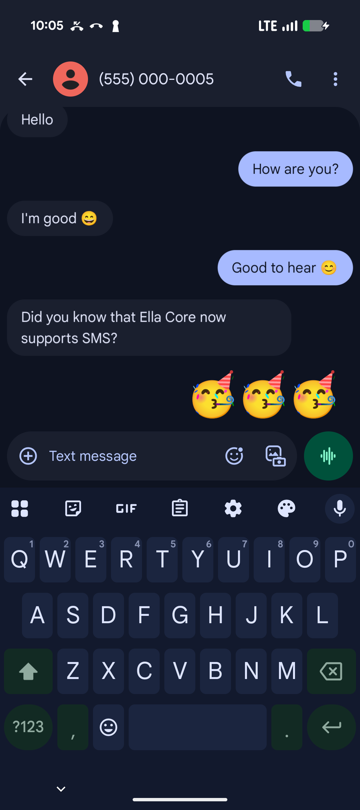

# Enable SMS

This guide connects Ella Core to an SMSC, such as [Ella SMSC](https://docs.ellanetworks.com/smsc/), so subscribers can send and receive SMS.

## 1. Configure the SMSC

In the Ella Core UI, go to **Integrations › SMS**. Under **This Core**, note the **Diameter Realm**, e.g. `epc.mnc001.mcc001.3gppnetwork.org`, and each node's **Origin-Host**.

Set your SMSC's HSS realm to the **Diameter Realm**. If your SMSC asks for Ella Core's Origin-Host, enter each node's.

## 2. Connect Ella Core to the SMSC

In **Integrations › SMS**, click the edit icon next to **Serving Node Number**, enter Ella Core's E.164 number for SMS, e.g. `+15550001111`, and click **Update**.

Click **Add SMSC** and configure the following settings:

- **Name**: a name for your SMSC, e.g. `main`.
- **Service Centre Addresses**: the E.164 service centre addresses your SMSC serves, e.g. `+15550000000`.
- **Diameter Peers**: the **Address** of your SMSC's Diameter endpoint. If your SMSC has several Diameter nodes, click **Add Diameter Peer** for each.

Click **Add**.

Validate that each node shows **Connected**.

## 3. Give subscribers an MSISDN

For each subscriber that should send or receive SMS:

- Go to the **Subscribers** page and click on the subscriber you want to configure.
- In Provisioning, click the edit icon next to MSISDN.
- Enter the subscriber's E.164 number, e.g. `+15551230001`, and click on **Update**.

## 4. Set the SMSC number on the phones

On each phone's SIM, set the SMSC number to one of your SMSCs' service centre numbers, in international format, e.g. `+15550000000`.

## 5. Send a test SMS

Send a test SMS message from a phone to another in your private mobile network. The message should be delivered successfully.

<figure markdown="span">
  { width="200" }
  <figcaption>Enable SMS in Ella Core</figcaption>
</figure>

To also deliver SMS over IP through an IMS, see Ella IMS's [Enable SMS over IP](https://docs.ellanetworks.com/ims/how_to/enable_sms_over_ip/).
