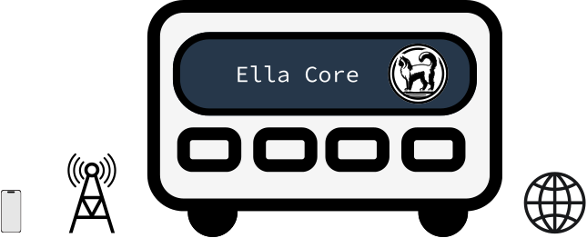

# Ella Core

  

**Ella Core** is a mobile core designed for private networks. It simplifies the complexity of traditional mobile networks into a single, easy-to-operate solution that is reliable and secure.

Use Ella Core where you need mobile connectivity: in a factory, a warehouse, a farm, a stadium, a ship, a military base, or a remote location.

## Key features

- **4G and 5G Compliant**: Ella Core implements 3GPP-standard interfaces and has been validated with multiple 4G and 5G radios, including integrated and software-defined RANs, commercial phones and devices. It is 5G RedCap compliant for IoT deployments.
- **Performant Data Plane**: Achieve high throughput and low latency with an eBPF-based data plane. Ella Core delivers over 10 Gbps of throughput and less than 1 ms of latency.
- **Lightweight**: Ella Core is a single binary with an embedded database, making it easy and quick to stand up. It requires as little as 1 CPU core, 1GB of RAM, and 10GB of disk space. Forget specialized hardware; all you need to operate your mobile core network is a Linux system with a network interface.
- **Highly Available**: Deploy Ella Core as a high-availability cluster to ensure continuous operation with failover capabilities.
- **Data, Voice, and SMS**: Data is built in. Integrate with an IMS for VoLTE and VoNR voice and video calls, and with an SMSC for SMS.
- **Enterprise Network Integration**: Plug into your existing network with BGP, VLANs, and VRFs. Define permitted network flows per subscriber, enforce them in the user plane, and track subscriber traffic and usage in real time.
- **AI-Native API**: Complete RESTful API and Go client for automation and integration. Manage your network programmatically or let AI agents do it securely using the OpenAPI specification and AI agent skill.
- **Easy to Operate**: Manage your private network through a user-friendly embedded web interface. Monitor network health with real-time observability: logs, metrics (Prometheus), traces (OTel), profiles, and dashboards. Keep track of who did what and when with audit logs, and back up and restore your data in 1 click.

## In this documentation

-   [__Tutorials__](tutorials/index.md)

    ---

    **Start here**: a hands-on introduction to Ella Core for new users. Install, configure, and initialize Ella Core in minutes.

-   [__How-to Guides__](how_to/index.md)

    ---

    **Step-by-step guides** covering key operation and common tasks.

-   [__Reference__](reference/index.md)

    ---

    **Technical information** - API, configuration, performance, metrics, and more.

-   [__Explanation__](explanation/index.md)

    ---

    **Discussion and clarification** of key topics.

