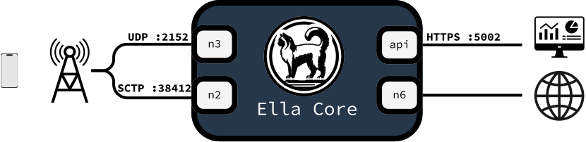
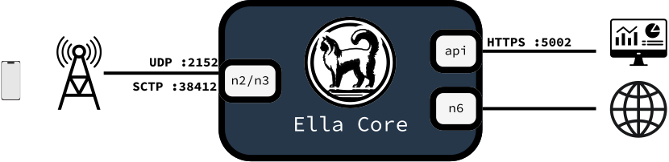
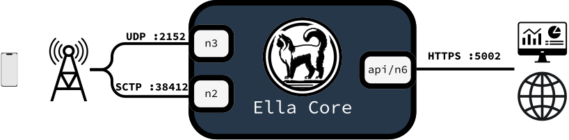
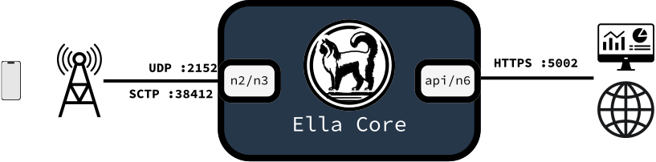

# Connectivity

Ella Core uses 4 different interfaces by default:

| Interface | Role | Transport | `name` | `address` | Address families |
| --------- | ---- | --------- | ------ | --------- | ---------------- |
| API | The HTTP API and UI | TCP, `interfaces.api.port` | Yes | Yes | IPv4, IPv6 |
| N2 / S1-MME | Control plane between Ella Core and the radio | SCTP, `38412` (5G) and `36412` (4G) by default | Yes | Yes | IPv4, IPv6. |
| N3 / S1-U | User plane between Ella Core and the radio | UDP `2152` | Yes | Yes | IPv4, IPv6. |
| N6 / SGi | User plane between Ella Core and the internet. Additional N6 interfaces can be set in `interfaces.network-instances`. | — | Yes | No | Not configurable |
| Cluster | Raft consensus and cluster HTTP between Ella Core nodes, over mTLS, when clustering is enabled | TCP, the port of `cluster.bind-address` | No | Yes | IPv4, IPv6 |
| SGd / S6c | SMS between Ella Core and the SMSCs, when SMS is enabled | SCTP, outbound to each SMSC node's port (`3868` by default) | No | No | IPv4, IPv6 |
| Diameter | Diameter from SMSC nodes, the IMS, including its IP-SM-GW, and roaming Diameter peers | SCTP and TCP, `interfaces.diameter.port` (`3868` by default). SMSC nodes and roaming peers over SCTP; IMS over SCTP or TCP. | Yes | Yes | IPv4, IPv6 |
| S6a | 4G roaming between Ella Core and the HSS or Diameter Edge Agent of roaming partners | SCTP, outbound to each roaming Diameter peer's port (`3868` by default) | No | No | IPv4, IPv6 |
| N32 | 5G roaming between Ella Core and the SEPPs of roaming partners | TCP, `interfaces.n32.port` (`443` by default), inbound and outbound | Yes | Yes | IPv4, IPv6 |

<figure markdown="span">
  { width="800" }
  <figcaption>Connectivity in Ella Core</figcaption>
</figure>

## Combining interfaces

It is possible to combine interfaces in the following manners.

### Combined N2 and N3

Many radios can use a single network link towards the core. In this case, N2 and N3 can be combined by using the same interface name for both of them in the configuration file.

<figure markdown="span">
  { width="800" }
  <figcaption>Combined N2 and N3</figcaption>
</figure>

### Combined API and N6

The API interface is often the network interface with internet access, and the N6 interface also requires internet access. They can be combined by using the same interface name for both in the configuration file.

<figure markdown="span">
  { width="800" }
  <figcaption>Combined API and N6</figcaption>
</figure>

### Combined API/N6 and combined N2/N3

It is possible to use both combination together to reduce the requirements to 2 interfaces.

<figure markdown="span">
  { width="800" }
  <figcaption>Combined All</figcaption>
</figure>

One or both of these interfaces can be virtual interfaces, with `veth`. See [Datapath constraints](#datapath-constraints).

### Combined on one interface

Ella Core can also be run with a single network interface. It can be achieved by using the same interface name in the configuration file, or by using VLANs.

## Using VLANs

It is possible to use VLAN interfaces, with or without combining interfaces
as described previously. In this case, the configuration file should contain
the name of the VLAN interface, not the parent interface.

## Datapath constraints

The datapath attaches to N3 and every N6 interface at the hook set by `datapath.attach-mode`. The shape of those interfaces constrains which modes work.

- **veth, `xdp-native`**: an XDP program must be attached to the peer interface, see the [explanation](../explanation/user_plane_packet_processing_with_ebpf.md#xdp-redirect-on-veth-pairs) and the [setup guide](../how_to/native_xdp_veth.md).
- **veth, `xdp-generic`**: TX checksum offload must be disabled on both ends (`ethtool -K <veth> tx off`), or decapsulated packets are silently corrupted.
- **Any interface, `tcx` or `xdp-generic`**: the interface must not deliver merged packets, see [Disable merged packets](../how_to/disable_merged_packets.md). 

## MTU

The MTU of a data network is the largest packet a subscriber sends or receives. On N3, each of these packets is carried in GTP-U ([TS 29.281](https://www.etsi.org/deliver/etsi_ts/129200_129299/129281/)):

| Header | Size (bytes) |
| ------ | ------------ |
| Outer IPv4 / IPv6 | 20 / 40 |
| UDP | 8 |
| GTP-U | 8, plus 4 when the sequence number, N-PDU number or next extension header field is present, plus any extension headers |

The data network MTU must not exceed the MTU of the path between the radio and Ella Core, minus the GTP-U overhead and the overhead of every tunnel on that path, such as IPsec.

| Setting | Default |
| ------- | ------- |
| Data network MTU | `1400` |
| Configuration | The data network's page in the UI, or the [Networking API](api/networking.md) |

## NAT

| Property | Behaviour |
| -------- | --------- |
| Default | Enabled on every slice and data network, except IMS data networks |
| Address family | IPv4 only |
| Scope | Per slice and data network. Uplink traffic leaving N6, sourced from the N6 address. Sessions on IMS data networks are never translated. |
| Translated protocols | TCP, UDP, and ICMP |
| Source ports | `1024`-`32767` |
| Downlink traffic | Delivered only when it matches a translation the subscriber's own traffic created. |
| Untranslatable traffic | IP fragments (`nat_fragment`) and protocols without ports, such as ESP and GRE (`nat_unsupported_proto`), are dropped. Protocols that embed addresses in their payload, such as FTP in active mode, do not work |
| Configuration | The **Slices** section of the data network's page in the UI, or the [Slices API](api/slices.md#update-a-data-network-of-a-slice). Changes apply to established sessions and break their established connections. |
